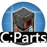

  

# Cosmonautics Parts

**Cosmonautics Parts** is a distilled standalone edition of **Create: Cosmonautics** for **Create Aeronautics** and **Sable**. It extracts the mod's aerospace propulsion, power, avionics, and flight equipment so every part works cleanly on airships, planes, rockets, and contraptions in normal dimensions — with space dimensions, planetary orbits, lunar worldgen, and external telemetry servers removed.

---

## Included Parts & Mechanics

* **Propulsion & Thrusters:** Rocket Thruster, Vector Thruster (gimbaled), Solid-Fuel Booster Thruster, Creative Thruster, RCS Thrusters (standard, brass, copper, and railway-encased), Ion Engine, and Modular Thruster Mounts with interchangeable Nozzles (`Copper` / `Titanium`) and Engine Cycle Pipes (`Closed`, `Open`, `Full-flow`, `Expander`).
* **Attitude Control & Staging:** Gyrodyne (CMG with `SAS`, `Hold`, `Prograde`, `Retrograde`, `Horizon`, `Sun`, and directional modes) and Redstone-triggered Stage Separators (standard, Charge, Shaft).
* **Avionics & Automation:** Sputnik Probe (chunk loading, node-graph logic editor, Wireless Sputnik Links, and optional ComputerCraft peripheral integration) and Multi-Function Flight Display (`MFD` + Lua `MFD Cartridges`).
* **Power & Fluid Systems:** Solar Panels (combinable arrays), Copper Wires, modular multiblock Energy Tanks, Drain Valves & tank pressure/fuel-mass mechanics, and Hose Anchors.
* **Flight Equipment & Materials:** Jetpack (uses pressurized air / liquid fuel), Copper Leg Thrusters, Copper Anchor Boots, Space Helmet, and Overworld Titanium Ore / Titanium Alloy progression.
* **Built-in Documentation:** Create Ponder scenes for thruster assembly, RCS placement, and Gyrodyne operation.

---

## Dependencies (Minecraft 1.21.1 / NeoForge)

* **Java 21**
* **NeoForge** `21.1.1+` (built against `21.1.249`)
* **Create** `6.0.11+` (`1.21.1`)
* **Create Aeronautics** `1.0.0+`
* **Sable** `2.0.3+`
* *Optional:* **CC: Tweaked**, **JEI**, **Jade**

---

## Building from Source

1. Clone the repository.
2. Run `./gradlew test build` to compile, run unit tests, and produce `build/libs/cosmonautics-parts-<version>.jar`.
3. Use `./gradlew runClient` to launch a test client.

---

## License

Copyright (C) 2026 **Element1M**

This project is licensed under the **GNU General Public License v3.0**. Detailed terms can be found in [LICENSE](LICENSE) and [NOTICE](NOTICE).
Derived from **Create: Cosmonautics** (originally by webyep-art, M_W_K, and the CosmonauticsTeam contributors).
